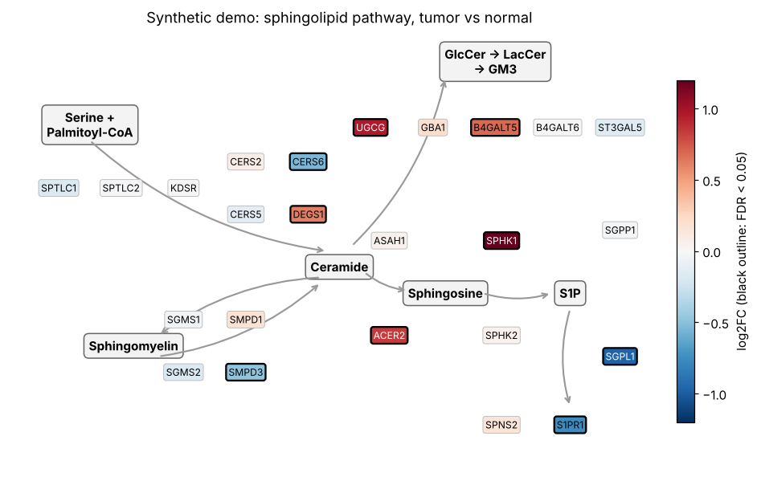
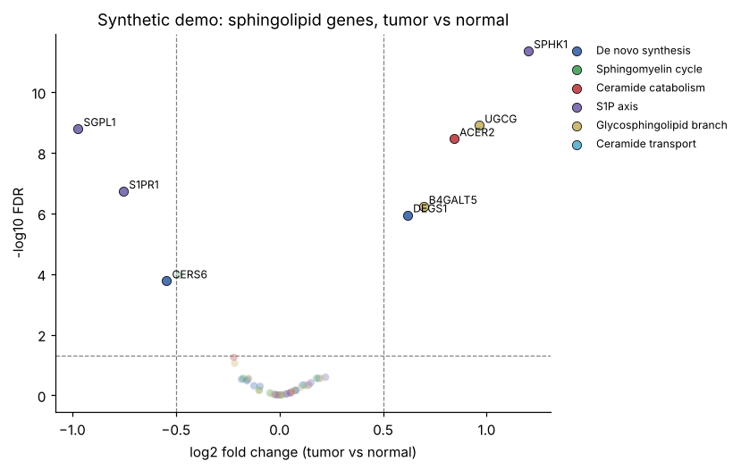
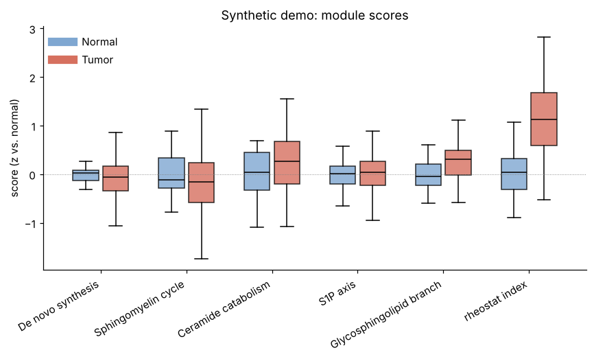
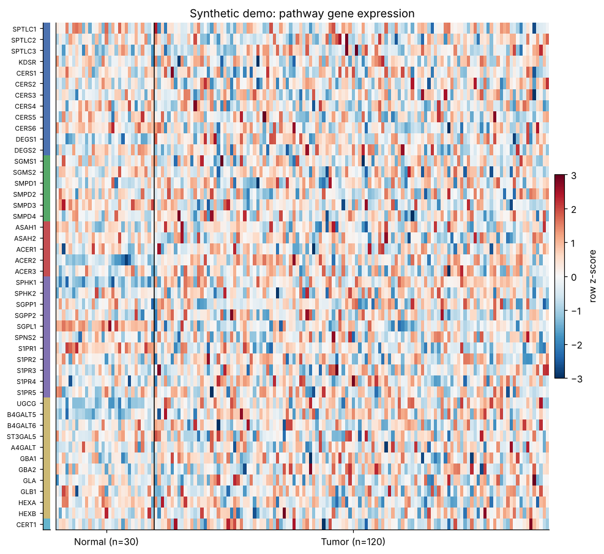
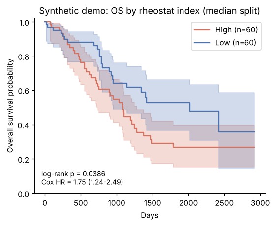

# sphingomap

**Sphingolipid pathway expression analysis for cancer transcriptomes — tumor vs. normal, pathway scores and clinical outcome in TCGA colorectal cancer.**

[](https://github.com/DhruvASharma2004/sphingomap/actions/workflows/ci.yml)
[](https://github.com/DhruvASharma2004/sphingomap/actions/workflows/tcga.yml)


<p align="center"></p>

## Why

Ceramide, sphingosine‑1‑phosphate (S1P) and glycosphingolipids such as lactosylceramide are
bioactive lipids with opposing effects on cell fate: ceramide pushes cells toward growth arrest
and apoptosis, while S1P and the glycosphingolipid branch support proliferation, survival,
migration and angiogenesis. This balance — the *sphingolipid rheostat* — is a recurring theme in
colorectal cancer and cardiovascular disease, and many of its enzymes (SPHK1, UGCG, the
ceramide synthases, acid ceramidase) are drug targets.

Lipidomics is expensive and rarely available for large cohorts, but transcriptomes are. **sphingomap**
asks a focused question of public RNA‑seq: *how is the expression of the sphingolipid machinery
re-wired in tumors, and does that re-wiring track with stage or survival?*

## What it does

| Step | Method |
|---|---|
| **Curated gene sets** | 46 enzymes, transporters and receptors in 6 modules: de novo synthesis, sphingomyelin cycle, ceramide catabolism, S1P axis, glycosphingolipid (GlcCer/LacCer) branch, ceramide transport. Retired symbols (`LASS2`, `GBA`, `COL4A3BP`…) are harmonised automatically. |
| **Data access** | One command downloads TCGA expression (RSEM, log2), clinical and survival tables from the UCSC Xena hub. Any genes × samples table also works. |
| **Tumor vs. normal** | Welch's *t*‑test + Mann–Whitney U, Benjamini–Hochberg FDR; **paired** *t*/Wilcoxon on patients with matched normal tissue. |
| **Pathway scores** | Per-sample module scores (mean *z* relative to normal tissue) and a **rheostat index** = pro‑survival (S1P/GSL) minus pro‑ceramide gene score. |
| **Clinical links** | Kruskal–Wallis and Spearman trend across pathologic stage I–IV; Kaplan–Meier, log‑rank and Cox regression for overall survival. |
| **Output** | Markdown report, tidy CSVs, JSON summary, and figures: pathway map, volcano plot, clustered heatmap, score box plots, KM curves. |
| **Engineering** | Installable package + CLI, 15 unit/integration tests, GitHub Actions CI, and a workflow that re-runs the real TCGA analysis on every change and commits the results. |

## Quick start

```bash
git clone https://github.com/DhruvASharma2004/sphingomap.git
cd sphingomap
pip install -e .

# Real data: TCGA colon + rectal adenocarcinoma (downloads ~60 MB from UCSC Xena)
sphingomap tcga COAD READ -o results/TCGA-COADREAD

# Offline demo on a synthetic TCGA-formatted cohort
sphingomap demo -o results/demo

# Your own data (genes x samples, log-scale; TCGA-style barcodes define tumor/normal)
sphingomap run -e expr.tsv -c clinical.tsv -s survival.tsv -l "My cohort" -o results/mine

# Inspect the gene sets
sphingomap genes
```

Results land in the output folder:

```
REPORT.md                    human-readable summary with figures
differential_expression.csv  per-gene log2FC, unpaired + paired tests, FDR
sample_scores.csv            module scores + rheostat index per sample
score_tumor_vs_normal.csv    module-level tumor vs normal tests
stage_association.csv        stage I-IV tests (tumors only)
summary.json                 machine-readable summary
figures/                     pathway_map, volcano, heatmap, module_scores, km_rheostat
```

## Results

**TCGA‑COAD + READ:** the [TCGA workflow](.github/workflows/tcga.yml) runs the full analysis on
GitHub's servers and writes the report to [`results/TCGA-COADREAD/REPORT.md`](results/TCGA-COADREAD/REPORT.md).

**Pipeline demo (synthetic data):** the figures below come from the simulated cohort in
`sphingomap/simulate.py`, which has planted effects so you can see that the pipeline recovers them.
They are *not* biological findings.

| | |
|---|---|
|  |  |
|  |  |

## Methods notes

- **Input scale.** Xena `HiSeqV2` values are log2(RSEM normalized count + 1); fold changes are differences of group means on that scale. Genes with mean log2 expression ≤ 1 in both groups are dropped before testing.
- **Sample groups.** TCGA barcode sample-type codes `01` (primary tumor) and `11` (solid tissue normal) define groups; patients with both give matched pairs.
- **Scores.** Each gene is z‑scored against the normal samples, then averaged within a module, so a score of +1 means "one normal-tissue SD above normal on average".
- **Rheostat index.** Pro-survival: SPHK1, SPHK2, S1PR1, SPNS2, UGCG, B4GALT5, B4GALT6, ACER2. Pro-ceramide: CERS2, CERS5, CERS6, SMPD1, SMPD3, SGPP1, SGPL1, GBA1. This is an exploratory, transcript-level heuristic — not a validated biomarker.
- **Survival.** Tumors are split at the median rheostat index for KM/log‑rank; Cox HR is reported per unit of the continuous index.

## Limitations

mRNA abundance does not equal enzyme activity or lipid levels; several enzymes are regulated
post‑translationally and by substrate availability. Bulk tumor RNA mixes cancer, stromal and
immune cells. Findings here are hypothesis-generating and should be followed up with
lipidomics (LC‑MS/MS, HPTLC) and functional experiments.

## Roadmap

- [ ] Additional cohorts (GEO colorectal series, TCGA pan-cancer)
- [ ] Consensus molecular subtype (CMS) and MSI stratification
- [ ] Single-cell deconvolution of pathway expression by cell type
- [ ] Multivariable Cox models adjusting for stage and age

## Project layout

```
sphingomap/
  genesets.py   curated modules, aliases, rheostat genes, pathway layout
  io.py         Xena download, loaders, TCGA barcode parsing
  stats.py      Welch / Mann-Whitney / paired tests, BH-FDR, stage association
  scores.py     module scores and rheostat index
  survival.py   Kaplan-Meier, log-rank, Cox
  plots.py      figures
  pipeline.py   end-to-end run + Markdown report
  simulate.py   synthetic TCGA-format cohort for tests and demos
  cli.py        command-line interface
tests/          pytest suite
```

## References

- Cuvillier O. *et al.* Suppression of ceramide-mediated programmed cell death by sphingosine-1-phosphate. *Nature* 381, 800–803 (1996).
- Hannun Y. A. & Obeid L. M. Sphingolipids and their metabolism in physiology and disease. *Nat. Rev. Mol. Cell Biol.* 19, 175–191 (2018).
- Ogretmen B. Sphingolipid metabolism in cancer signalling and therapy. *Nat. Rev. Cancer* 18, 33–50 (2018).
- Cancer Genome Atlas Network. Comprehensive molecular characterization of human colon and rectal cancer. *Nature* 487, 330–337 (2012).
- Goldman M. J. *et al.* Visualizing and interpreting cancer genomics data via the Xena platform. *Nat. Biotechnol.* 38, 675–678 (2020).

## Author

**Dhruv Sharma** — M.S. Biotechnology, Johns Hopkins University. Research interests: sphingolipid biology in colorectal cancer and cardiovascular disease.

MIT licensed. Data from TCGA via UCSC Xena are subject to their respective terms of use.
