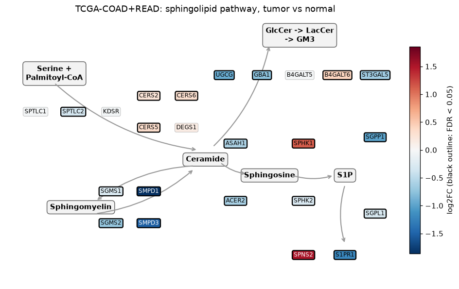
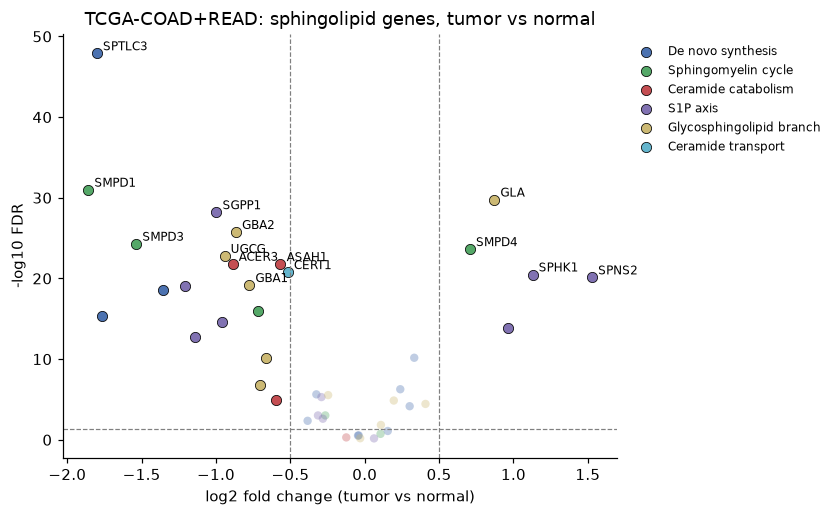
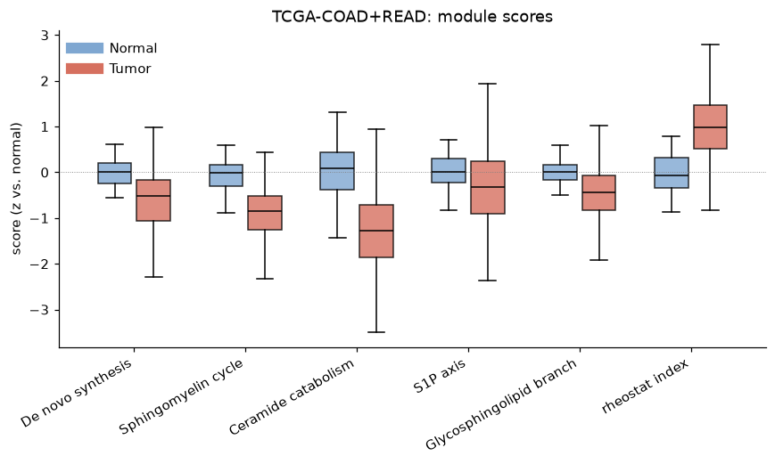
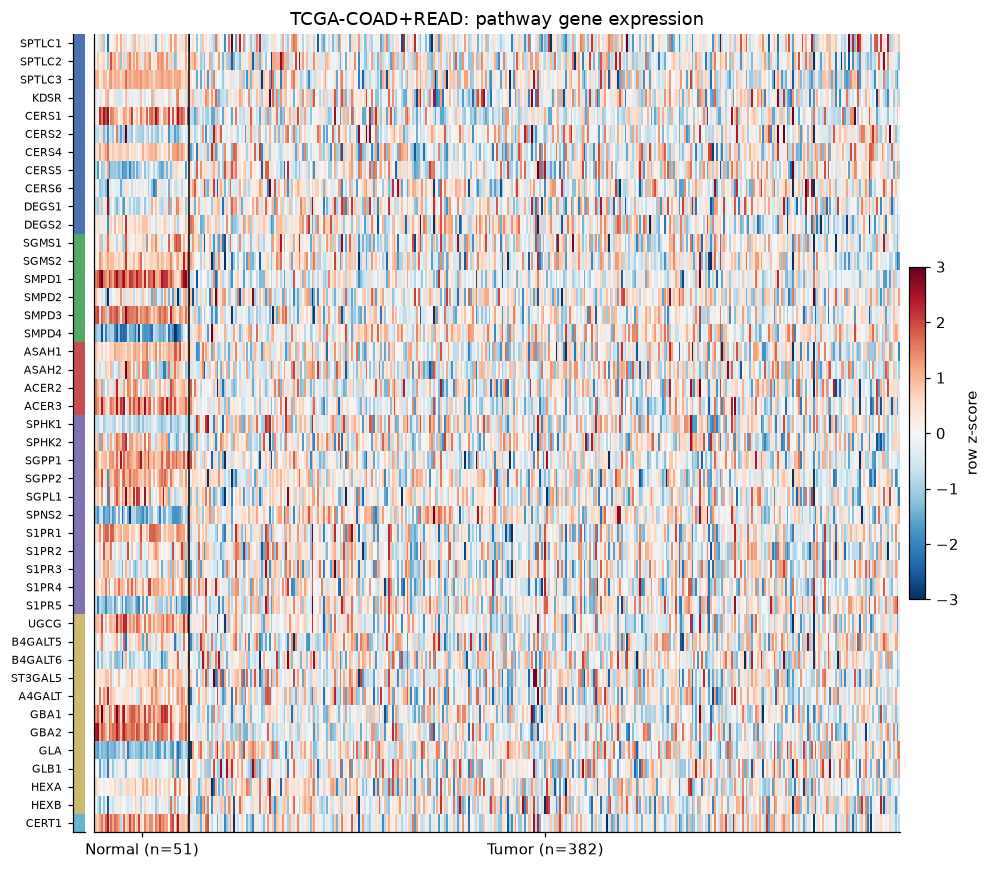
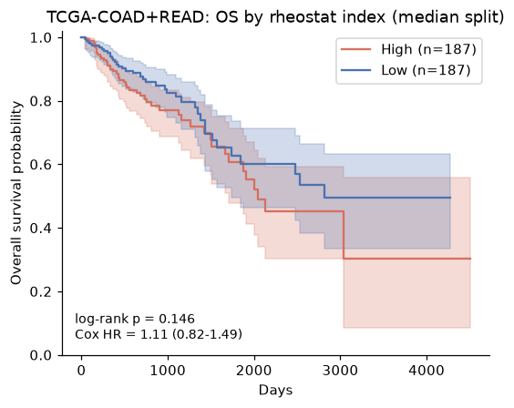

# Sphingolipid pathway report — TCGA-COAD+READ

_sphingomap v0.1.0, generated 2026-11-03_

## Cohort

- Tumor samples: **382**  
- Normal samples: **51** (32 matched pairs)
- Pathway genes found: 46 (44 expressed)

## Differential expression (Welch t-test, BH FDR)

24 genes with FDR < 0.05 and |log2FC| ≥ 0.5.

- Up in tumor: SPNS2, SPHK1, S1PR5, GLA, SMPD4
- Down in tumor: SMPD1, SPTLC3, CERS1, SMPD3, CERS4, S1PR1, S1PR4, SGPP1

| Gene | Module | log2FC | FDR |
|---|---|---:|---:|
| SPTLC3 | De novo synthesis | -1.80 | 1.27e-48 |
| SMPD1 | Sphingomyelin cycle | -1.86 | 1.03e-31 |
| GLA | Glycosphingolipid branch | +0.87 | 1.71e-30 |
| SGPP1 | S1P axis | -1.00 | 6.32e-29 |
| GBA2 | Glycosphingolipid branch | -0.87 | 1.79e-26 |
| SMPD3 | Sphingomyelin cycle | -1.54 | 5.18e-25 |
| SMPD4 | Sphingomyelin cycle | +0.71 | 2.37e-24 |
| UGCG | Glycosphingolipid branch | -0.94 | 1.66e-23 |
| ACER3 | Ceramide catabolism | -0.89 | 1.57e-22 |
| ASAH1 | Ceramide catabolism | -0.57 | 1.69e-22 |
| CERT1 | Ceramide transport | -0.52 | 1.69e-21 |
| SPHK1 | S1P axis | +1.13 | 3.29e-21 |
| SPNS2 | S1P axis | +1.53 | 7.61e-21 |
| GBA1 | Glycosphingolipid branch | -0.78 | 6.78e-20 |
| S1PR1 | S1P axis | -1.21 | 9.85e-20 |
| CERS4 | De novo synthesis | -1.36 | 2.59e-19 |
| SGMS2 | Sphingomyelin cycle | -0.72 | 1.17e-16 |
| CERS1 | De novo synthesis | -1.76 | 4.86e-16 |
| SGPP2 | S1P axis | -0.96 | 2.66e-15 |
| S1PR5 | S1P axis | +0.96 | 1.23e-14 |

## Module scores and rheostat index

Scores are mean z-scores relative to normal tissue.

| Score | Tumor − Normal | FDR |
|---|---:|---:|
| rheostat_index | +0.98 | 0.00e+00 |
| ceramide_catabolism | -1.32 | 0.00e+00 |
| sphingomyelin_cycle | -0.88 | 0.00e+00 |
| de_novo_synthesis | -0.61 | 0.00e+00 |
| glycosphingolipid_branch | -0.49 | 0.00e+00 |
| s1p_axis | -0.33 | 9.00e-06 |

## Association with pathologic stage (tumors)

| Score | n | Kruskal p | Spearman ρ | Spearman p |
|---|---:|---:|---:|---:|
| de_novo_synthesis | 359 | 0.919 | -0.00 | 0.986 |
| sphingomyelin_cycle | 359 | 0.609 | -0.02 | 0.682 |
| ceramide_catabolism | 359 | 0.0177 | -0.17 | 0.00153 |
| s1p_axis | 359 | 0.755 | +0.04 | 0.402 |
| glycosphingolipid_branch | 359 | 0.14 | -0.10 | 0.0513 |
| rheostat_index | 359 | 0.955 | +0.03 | 0.594 |

## Overall survival

Median split on rheostat index: n = 374, events = 86, log-rank p = 0.146; Cox HR per unit = 1.11 (95% CI 0.82–1.49, p = 0.501).

## Caveats

- Transcript abundance is not enzyme activity or lipid level; confirm with lipidomics.
- The rheostat index is an exploratory heuristic, not a validated biomarker.
- Unpaired tests treat tumor and normal as independent; see paired columns where available.
